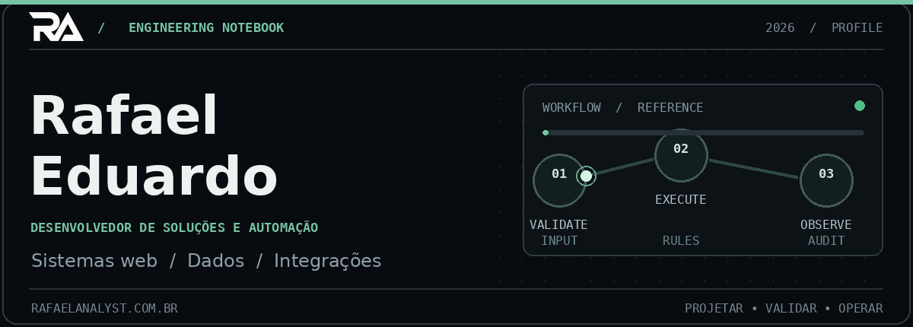
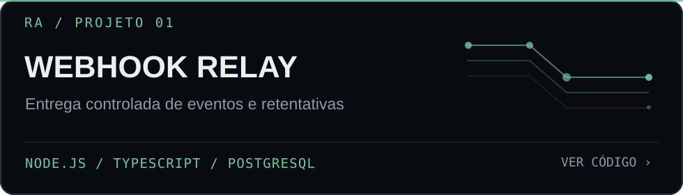
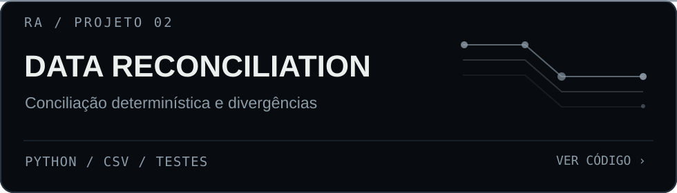
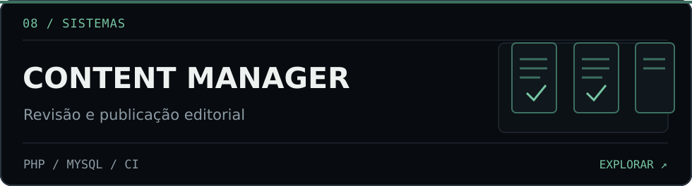

<!--
  RAFAEL ANALYST / PROFILE
  Version: 2.1-A / header correction
  Design: restrained motion, strong typographic hierarchy, real project evidence.
  All project cards link to publicly accessible repositories.
  The exact official logo is incorporated proportionally into the hero. No duplicate block below it.
-->

  <picture>
    <source media="(prefers-reduced-motion: reduce)" srcset="./assets/profile/hero-still.png" />
    
  </picture>

<!-- Compact navigation: SVG labels remain clickable links, without default blue hyperlink styling. -->

  
  
  

  
  
  
  
  

---

## 01 / O que eu construo

**Transformo problemas operacionais em sistemas que podem ser entendidos, testados e mantidos.**

Minha trajetória começou no backoffice, onde uma regra mal definida não vira apenas um bug: ela vira retrabalho, divergência, atraso e decisão tomada com informação incompleta.

Hoje atuo com **inteligência operacional** e desenvolvimento de soluções, combinando conhecimento de processo, engenharia de software e análise de dados. Em paralelo, desenvolvo projetos independentes na Rafael Analyst.

Trabalho com sistemas web, automações, integrações e dados. O ponto de partida, porém, quase nunca é a tecnologia: são as regras do negócio, suas exceções e a evidência necessária para confiar no resultado.

> **O objetivo não é automatizar o caos. É eliminar a ambiguidade antes de automatizar.**

## 02 / Engenharia aplicada à operação

  

O processo orienta a implementação: **entradas explícitas, invariantes verificáveis, efeitos previsíveis e evidências de execução**. Quando um fluxo envolve dados sensíveis, permissões ou integrações externas, segurança e recuperação fazem parte do desenho inicial, não de uma revisão tardia.

<table>
  <tr>
    <td width="50%" valign="top"><b>Na arquitetura</b> Responsabilidades isoladas, contratos claros, baixo acoplamento e mudanças incrementais.</td>
    <td width="50%" valign="top"><b>Na operação</b> Validação, rastreabilidade, conciliação, controle de acesso e tratamento explícito de falhas.</td>
  </tr>
  <tr>
    <td width="50%" valign="top"><b>Na entrega</b> Testes, documentação, configuração separada do código e revisão de regressões.</td>
    <td width="50%" valign="top"><b>Na manutenção</b> Logs úteis, diagnósticos reproduzíveis e decisões técnicas que outra pessoa consiga sustentar.</td>
  </tr>
</table>

## 03 / Projetos para explorar

Os repositórios abaixo contêm **implementações públicas de referência, estudos de engenharia e demonstrações com dados sintéticos**. Eles não devem ser confundidos com sistemas privados de clientes ou ambientes de produção.

**Clique em um card para abrir o código, os testes e a documentação.**

<table>
  <tr>
    <td width="50%"></td>
    <td width="50%"></td>
  </tr>
  <tr>
    <td width="50%"></td>
    <td width="50%"></td>
  </tr>
  <tr>
    <td width="50%"></td>
    <td width="50%"></td>
  </tr>
  <tr>
    <td width="50%"></td>
    <td width="50%"></td>
  </tr>
</table>

  <a href="https://github.com/RafaelEdrd?tab=repositories"><b>Ver todos os repositórios públicos ↗</b></a>

## 04 / Ferramentas de trabalho

Uso a ferramenta adequada ao contrato e ao ambiente de execução. A stack varia; a disciplina de validação, segurança e manutenção não deveria variar.

<table>
  <tr>
    <td align="center"> Python</td>
    <td align="center"> JavaScript</td>
    <td align="center"> TypeScript</td>
    <td align="center"> PHP</td>
    <td align="center"> React</td>
    <td align="center"> Node.js</td>
  </tr>
  <tr>
    <td align="center"> PostgreSQL</td>
    <td align="center"> MySQL</td>
    <td align="center"> HTML</td>
    <td align="center"> CSS</td>
    <td align="center"> Git</td>
    <td align="center"> FastAPI</td>
  </tr>
</table>

**Também no fluxo:** SQL, Google Apps Script, Power BI, Looker Studio, automações com n8n/Make e integrações via APIs REST/webhooks.

## 05 / Abra os bastidores

Há uma diferença entre mostrar um sistema e explicar **por que ele funciona, quando falha e como recuperar seu estado**. As seções abaixo são expansíveis; escolha o tema que quiser inspecionar.

<b>01 · Regras de negócio e consistência</b> — o que não pode dar errado?

### Invariantes antes da interface

- Um pedido com vários itens não pode reservar apenas parte da cesta.
- A mesma chave de idempotência não deve produzir duas operações diferentes.
- Um agendamento não pode sobrepor pausas, indisponibilidades ou reservas existentes.
- Uma conciliação precisa deixar explícitas as chaves, tolerâncias e divergências.

Os projetos **Commerce Control**, **Dispatch Planner** e **Data Reconciliation** apresentam referências testáveis desses problemas. Cada um documenta suas limitações em vez de sugerir garantias que não oferece.

<b>02 · Arquitetura e integração</b> — o que acontece quando algo falha?

### Falha não é exceção improvável

Em integrações e pipelines, procuro especificar o que é repetível, o que é irreversível e como identificar uma execução parcial. Validação antes da mutação, operações idempotentes, políticas de retentativa e trilhas de auditoria são ferramentas; sua adoção depende do contexto e do risco.

Nos repositórios, os exemplos são delimitados por escopo. A ausência de filas, transações distribuídas ou observabilidade de produção é declarada quando pertinente.

<b>03 · Segurança e responsabilidade</b> — o que não deve ser exposto?

### Secure by default

- Credenciais não entram no código versionado.
- Privilégios devem ser concedidos por necessidade, não por conveniência.
- Logs devem ajudar na auditoria sem se tornarem uma nova fonte de dados sensíveis.
- Demonstrações utilizam dados sintéticos e não representam acessos a clientes.

Cada repositório possui sua própria fronteira de publicação. Um projeto demonstrativo não deve ser anunciado como serviço seguro para produção sem autenticação, isolamento, transações e operação adequada.

<b>04 · Decisões e trade-offs</b> — por que não construir tudo?

### Complexidade é uma despesa permanente

Escolho uma arquitetura que resolva o problema presente sem bloquear a evolução previsível. Abstrações, novas dependências, infraestrutura e automações adicionais precisam justificar custo operacional e manutenção.

Prefiro um sistema pequeno, observável e testado a uma arquitetura impressionante que ninguém consegue sustentar.

---

  <b>Projetos explicáveis. Regras testáveis. Soluções sustentáveis.</b>

  <a href="https://rafaelanalyst.com.br">rafaelanalyst.com.br</a>
  &nbsp; · &nbsp;
  <a href="mailto:contato@rafaelanalyst.com.br">contato@rafaelanalyst.com.br</a>
  &nbsp; · &nbsp;
  <a href="https://github.com/RafaelEdrd">@RafaelEdrd</a>

RAFAEL ANALYST / PROFILE v2.1 · Ilustrações originais versionadas no próprio repositório · 2026

