<!--
RAFAEL ANALYST / GITHUB PROFILE
Version 2.4 · Editorial refactor
Identity: approved hero and original RA + Rafael Analyst mark, unchanged.
Visual assets are local; the profile works without JavaScript or external statistic services.
The eight project cards point to public reference implementations, not client production systems.
-->

  <picture>
    <source media="(prefers-reduced-motion: reduce)" srcset="./assets/profile/hero-still.png" />
    
  </picture>

  
  
  

  
  
  
  
  

<h2>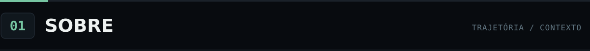</h2>

**Desenvolvo soluções para operações que precisam funcionar também quando algo sai do esperado.**

Comecei no backoffice, lidando com informações divergentes, atividades manuais e regras que nem sempre estavam documentadas. Essa experiência mudou minha forma de desenvolver: antes de pensar na interface, procuro entender o processo, a origem dos dados, as exceções e quem depende da resposta do sistema.

Hoje atuo com **inteligência operacional** e desenvolvimento de soluções. Em paralelo, construo projetos independentes pela Rafael Analyst, com foco em sistemas web, automações, integrações e análise de dados.

  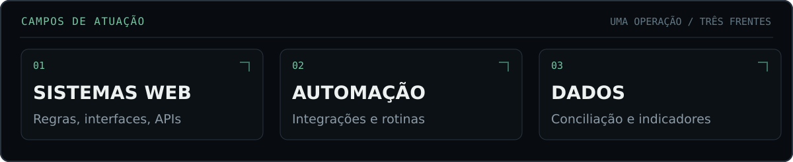

Não procuro apenas automatizar uma tarefa. Procuro deixar o processo mais claro, a informação mais confiável e a solução mais simples de manter.

<h2>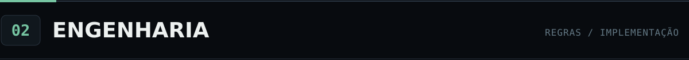</h2>

A implementação é consequência das regras. Uma solução precisa deixar explícito **o que recebe, o que pode alterar, como falha e como alguém verifica o resultado**.

  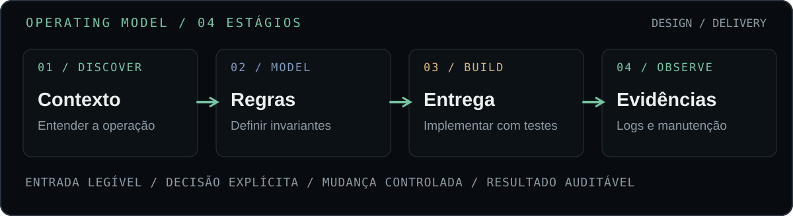

| Princípio | Aplicação prática |
| :--- | :--- |
| **Contratos claros** | Validação de entradas, limites, estados e exceções antes de qualquer mutação. |
| **Consistência** | Idempotência, reconciliação, regras de concorrência e transações quando o contexto exige. |
| **Evolução controlada** | Testes automatizados, mudanças incrementais e compatibilidade com fluxos existentes. |
| **Operação sustentável** | Logs úteis, documentação, diagnóstico de falhas e caminhos de recuperação. |

Não trato essas garantias como universais: cada projeto explicita suas limitações e o que precisaria mudar para um ambiente de produção.

<h2>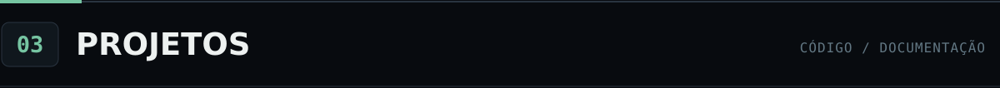</h2>

Aqui estão **oito implementações públicas**, com código, documentação e, conforme o repositório, testes de referência. São demonstrações técnicas e estudos de engenharia com dados sintéticos; não representam implantações em clientes.

SELECIONE UM PROJETO PARA ABRIR O REPOSITÓRIO

<a href="https://github.com/RafaelEdrd/process-forge" title="Abrir repositório Process Forge">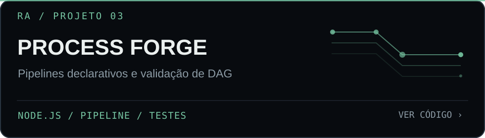</a>

<a href="https://github.com/RafaelEdrd/approval-workflow" title="Abrir repositório Approval Workflow">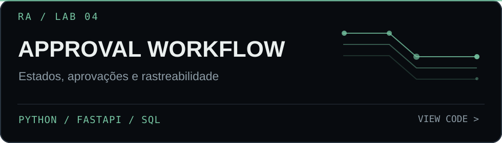</a>

<a href="https://github.com/RafaelEdrd/dispatch-planner" title="Abrir repositório Dispatch Planner">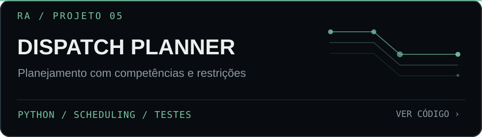</a>

<a href="https://github.com/RafaelEdrd/commerce-control" title="Abrir repositório Commerce Control">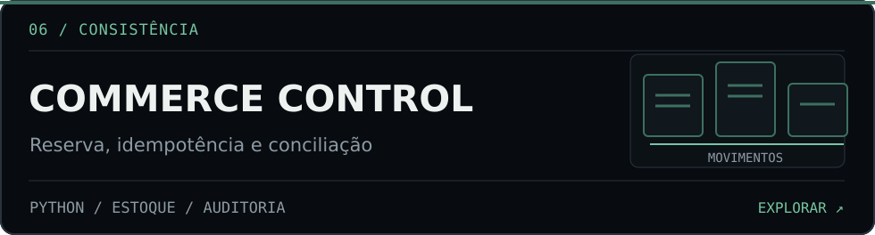</a>

<a href="https://github.com/RafaelEdrd/operations-dashboard" title="Abrir repositório Operations Dashboard">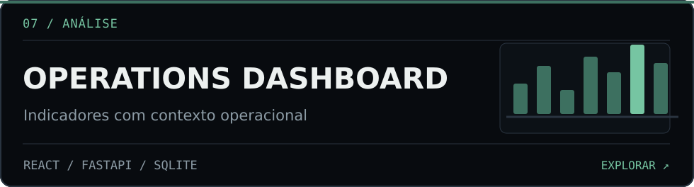</a>

  <a href="https://github.com/RafaelEdrd?tab=repositories">Consultar todos os repositórios públicos</a>

<h2>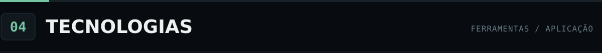</h2>

A escolha da tecnologia depende do ambiente, dos dados, da equipe e do custo de manutenção. Estas são algumas das ferramentas presentes nos meus projetos e rotinas de desenvolvimento.

<table>
  <tr>
    <td align="center" width="25%"> Python</td>
    <td align="center" width="25%"> JavaScript</td>
    <td align="center" width="25%"> TypeScript</td>
    <td align="center" width="25%"> PHP</td>
  </tr>
  <tr>
    <td align="center"> React</td>
    <td align="center"> Node.js</td>
    <td align="center"> PostgreSQL</td>
    <td align="center"> MySQL</td>
  </tr>
  <tr>
    <td align="center"> HTML</td>
    <td align="center"> CSS</td>
    <td align="center"> Git</td>
    <td align="center"> FastAPI</td>
  </tr>
</table>

**Outras ferramentas de trabalho:** SQL, Google Apps Script, Power BI, Looker Studio, GitHub Actions, Make, n8n, APIs REST e webhooks.

<h2>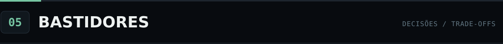</h2>

Um repositório diz mais quando é possível inspecionar **por que uma decisão foi tomada**, não apenas observar o resultado. As seções abaixo podem ser abertas individualmente.

<b>01 · Regras de negócio</b> — o que precisa permanecer verdadeiro?

Uma regra importante deve ser testável e compreensível fora da interface. Exemplos dos projetos:

- **Commerce Control:** uma cesta não pode ser parcialmente reservada se algum item estiver indisponível.
- **Dispatch Planner:** horários incompatíveis e agendamentos sobrepostos devem ser rejeitados sem criar reservas parciais.
- **Data Reconciliation:** chaves, critérios de comparação e divergências precisam ser explícitos.

O comportamento real de cada referência está delimitado nos respectivos READMEs e testes.

<b>02 · Integrações e falhas</b> — como identificar uma execução incompleta?

Integrações confiáveis precisam de regras para repetição, tempo de espera, validação e recuperação. Nem toda operação pode ser refeita com segurança, e nem todo erro deve gerar retentativa automática.

No **Webhook Relay**, os mecanismos de entrega e retentativa são estudados em uma implementação de referência. No **Process Forge**, a validação de dependências e de operadores impede executar configurações inválidas.

<b>03 · Segurança e dados</b> — o que não deve circular pelo sistema?

- Credenciais fora do código e fora dos repositórios públicos.
- Permissões mínimas por responsabilidade e segregação quando necessária.
- Logs com contexto suficiente para investigação, sem expor informações pessoais desnecessárias.
- Dados de demonstração sintéticos e separação explícita entre referência técnica e sistema operacional.

Esses são critérios de engenharia, não uma afirmação de que os protótipos públicos estejam prontos para produção.

<b>04 · Decisões técnicas</b> — por que a solução mais simples pode ser melhor?

A arquitetura precisa ser proporcional ao problema. Uma dependência adicional, um novo serviço ou uma abstração sofisticada só valem a pena quando reduzem o custo total de operar e evoluir o produto.

Busco **baixo acoplamento, testes reproduzíveis, falhas explícitas e documentação útil**. Prefiro uma implementação menor com limites conhecidos a uma promessa ampla que não consigo sustentar.

  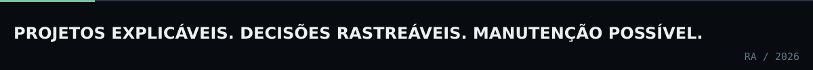

  <a href="https://rafaelanalyst.com.br">Site</a> &nbsp;·&nbsp;
  <a href="https://www.linkedin.com/in/rafaeleduardo-analyst/">LinkedIn</a> &nbsp;·&nbsp;
  <a href="mailto:contato@rafaelanalyst.com.br">Contato</a>

RAFAEL ANALYST / PROFILE v2.4 · Recursos visuais locais · 2026

